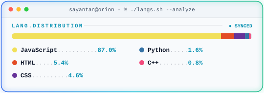
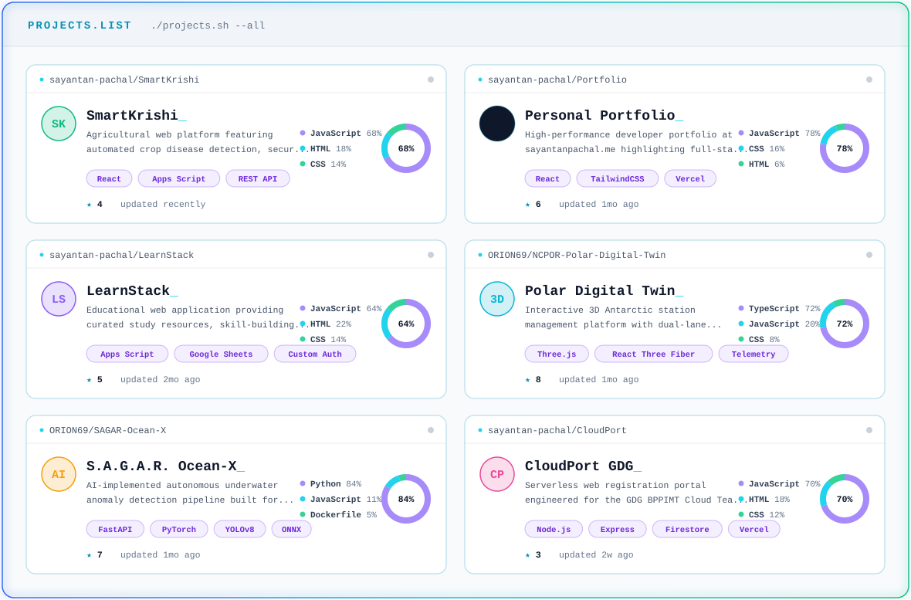

<!-- HERO TERMINAL (profile.sh) -->

  <picture>
    <source media="(prefers-color-scheme: dark)" srcset="./profile-dark.svg" />
    <source media="(prefers-color-scheme: light)" srcset="./profile-light.svg" />
    
  </picture>

 

<!-- ENGINEERING MINDSET & TECH STACK -->

  

    Passionate about <b>problem-first software engineering</b>, resilient full-stack architectures, interactive 3D web systems, and applied AI.
  

  

    
  

  

    
    
    
  

 

<!-- GITHUB TELEMETRY (stats.sh, streak.sh, langs.sh) -->
<table align="center" style="border: none; background: transparent;">
  <tr>
    <td align="center" style="border: none; padding: 6px;">
      
    </td>
    <td align="center" style="border: none; padding: 6px;">
      
    </td>
  </tr>
  <tr>
    <td colspan="2" align="center" style="border: none; padding: 6px;">
      
    </td>
  </tr>
</table>

 

<!-- PROJECTS SHOWCASE (projects.sh) -->

  

 

<!-- CONTRIBUTION SNAKE / ACTIVITY -->

  <picture>
    <source media="(prefers-color-scheme: dark)" srcset="https://raw.githubusercontent.com/sayantan-pachal/sayantan-pachal/output/snake-dark.svg" />
    <source media="(prefers-color-scheme: light)" srcset="https://raw.githubusercontent.com/sayantan-pachal/sayantan-pachal/output/snake-light.svg" />
    
  </picture>

 

<!-- FOOTER & SOCIALS -->

  
<i>"Coding is like art, but the paint never dries."</i> 🎨

  

    &nbsp;&nbsp;
    &nbsp;&nbsp;
    &nbsp;&nbsp;
    
  

